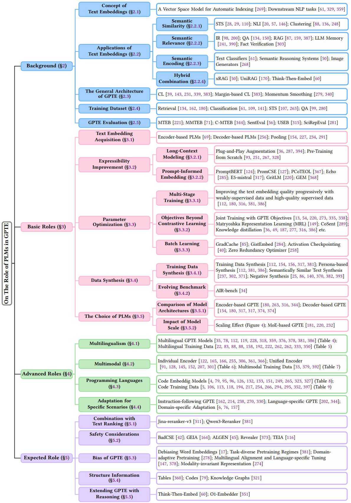
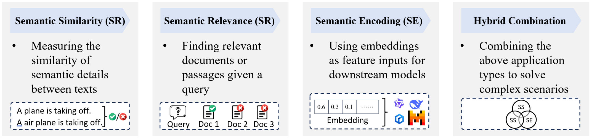
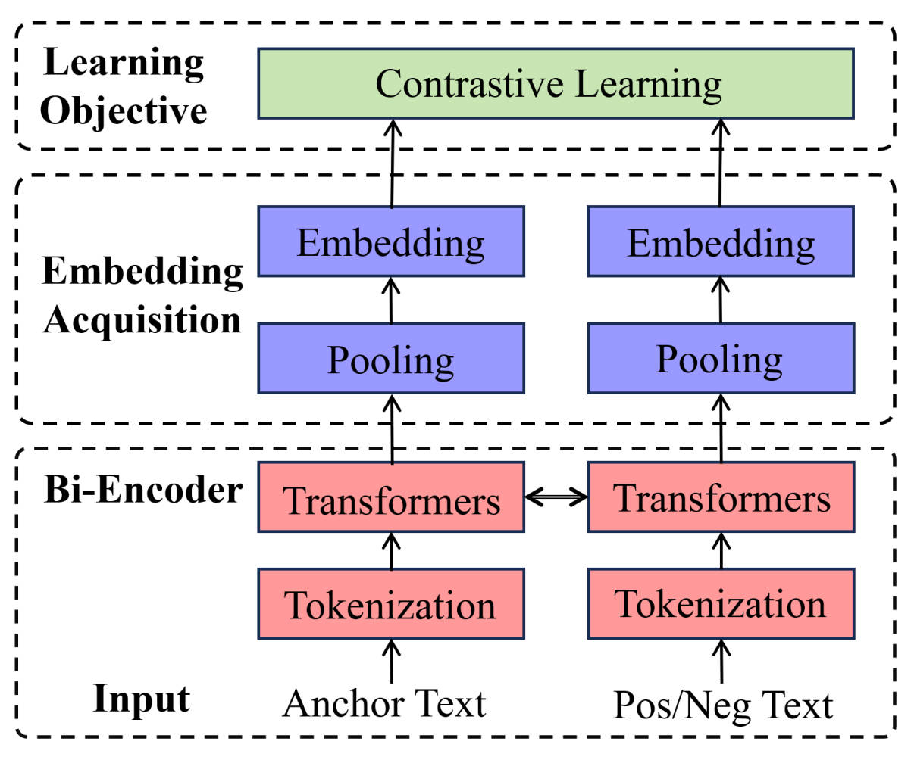
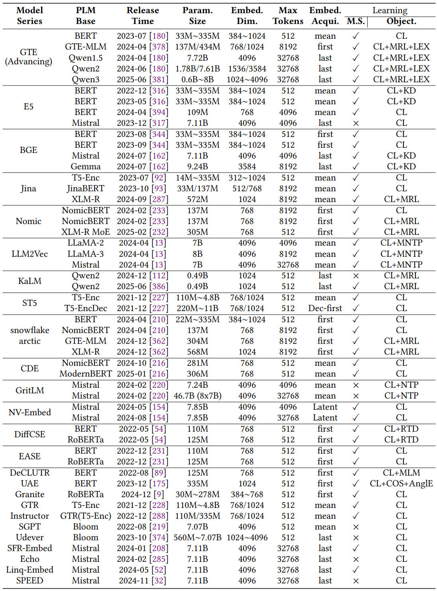
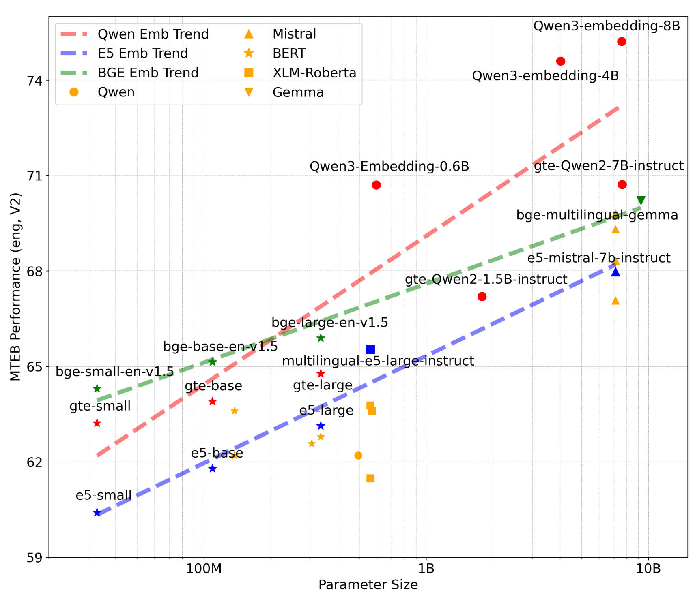

# On The Role of Pretrained Language Models in General-Purpose Text Embeddings: A Survey (Text Embedding Survey)

Text embeddings have attracted growing interest due to their effectiveness across a wide range of natural language processing (NLP) tasks, including retrieval, classification, clustering, bitext mining, and summarization. With the emergence of pretrained language models (PLMs), general-purpose text embeddings (GPTE) have gained significant traction for their ability to produce rich, transferable representations. The general architecture of GPTE typically leverages PLMs to derive dense text representations, which are then optimized through contrastive learning on large-scale pairwise datasets. In this survey, we provide a comprehensive overview of GPTE in the era of PLMs, focusing on the roles PLMs play in driving its development. We first examine the fundamental architecture and describe the basic roles of PLMs in GPTE, i.e., embedding extraction, expressivity enhancement, training strategies, learning objectives, and data construction. We then describe advanced roles enabled by PLMs, including multilingual support, multimodal integration, code understanding, and scenario-specific adaptation. Finally, we highlight potential future research directions that move beyond traditional improvement goals, including ranking integration, safety considerations, bias mitigation, structural information incorporation, and the cognitive extension of embeddings. This survey aims to serve as a valuable reference for both newcomers and established researchers seeking to understand the current state and future potential of GPTE. 

**Paper Link:** [https://arxiv.org/abs/2507.20783](https://arxiv.org/abs/2507.20783)

## 📆 Updates

- [2026/1/26] We created the repository on GitHub.
- [2025/11/26] We released the second version of our survey on arXiv.
- [2025/7/28] We released the first version of our survey on arXiv.

## 📋 Table of Contents

- [Taxonomy of PLMs’ Roles in GPTE](#taxonomy)
- [Four typical applications of text embedding](#application)
- [The General Architecture of GPTE](#architecture )
- [Representative open-source GPTE models](#models)
- [Comparisons of GPTE models](#comparison)
- [Citation](#citation)
- [Contact Us](#contact)

## <a name="taxonomy">📕 Taxonomy of PLMs’ Roles in GPTE



We divide PLMs’ Roles in GPTE into three categories: (1) We first examine the fundamental architecture and describe the **basic roles** of PLMs in GPTE, *i.e.,* embedding extraction, expressivity enhancement, training strategies, learning objectives, and data construction; (2) We then describe **advanced roles** enabled by PLMs, including multilingual support, multimodal integration, code understanding, and scenario-specific adaptation；(3) Finally, we highlight potential future research directions (**Expected Roles**) that move beyond traditional improvement goals, including ranking integration, safety considerations, bias mitigation, structural information incorporation, and the cognitive extension of embeddings.

## <a name="application">📗 Four typical applications of text embedding



Text embedding applications can be broadly categorized into three types based on their primary purpose: **semantic similarity**, **semantic relevance**, and **semantic encoding**. The first two focus on bi-text semantic computations, where the last type involves representing individual texts as high-level features for downstream tasks. Semantic similarity typically refers to symmetric tasks where both texts are treated equally, while semantic relevance addresses asymmetric tasks where one text is semantically related to another. Additionally, **several hybrid cases** exist within text embedding applications. 

## <a name="architecture">📘 The General Architecture of GPTE


The above framework illustrates the mainstream architecture for pretraining GPTE through a supervised approach. Typically, the textual word sequence is **fed into a well-established PLM backbone** (the key neural network is transformers), **generating hidden contextual representations** of words. Following this, **a pooling step aggregates these word-level hidden vectors** into a single vector, yielding the embedding form of the input text. Once the embedding network is ready, **the subsequent phase involves further optimization beyond the PLM’s initial capabilities**, for which **contrastive learning (CL)** is the widely-accepted supervision objective. This learning process can be **self-supervised, weakly-supervised, or high-quality supervised through bi-encoder semantic computation**.


## <a name="models">📙 Representative open-source GPTE models


Representative open-source GPTE models (English-centered), where only models released on Huggingface with detailed and clear documentation are listed. New Abbreviations: M.S. = multistage training; MNTP = masked next token prediction training; COS = cosine objective.


## <a name="comparison">🔎 Comparisons of GPTE models



Comparisons of GPTE models with various PLM backbones, focusing on those of widely-adopted open-source PLMs.

## 📑 Paper List
### Basic Roles
#### Text Embedding Acquisition
##### Encoder-based PLMs

- BERT: Pre-training of Deep Bidirectional Transformers for Language Understanding, NAACL-HLT 2019, [[paper]](https://aclanthology.org/N19-1423.pdf).
- RoBERTa: A Robustly Optimized BERT Pretraining Approach, arxiv, 2019, [[paper]](https://arxiv.org/abs/1907.11692).
- Unsupervised Cross-lingual Representation Learning at Scale, ACL, 2020, [[paper]](https://aclanthology.org/2020.acl-main.747.pdf).

##### Decoder-based PLMs

- Improving language understanding by generative pre-training, OpenAI, 2018, [[paper]](https://cdn.openai.com/research-covers/language-unsupervised/language_understanding_paper.pdf).
- Qwen3 Technical Report, arxiv, 2025, [[paper]](https://arxiv.org/pdf/2505.09388).

##### Pooling

- NV-Embed: Improved Techniques for Training LLMs as Generalist Embedding Models, ICLR, 2025, [[paper]](https://openreview.net/pdf?id=lgsyLSsDRe).
- Don’t Judge a Language Model by Its Last Layer: Contrastive Learning with Layer-Wise Attention Pooling, Coling, 2022, [[paper]](https://aclanthology.org/2022.coling-1.405.pdf).
- Whitening sentence representations for better semantics and faster retrieval, arxiv, 2021, [[paper]](https://arxiv.org/pdf/2103.15316).

#### Expressibility Improvement
##### Long-Context Modeling
+ M3-Embedding: Multi-Linguality, Multi-Functionality, Multi-Granularity Text Embeddings Through Self-Knowledge Distillation, ACL Findings, 2024, [[paper]](https://aclanthology.org/2024.findings-acl.137.pdf).
+ jina-embeddings-v3: Multilingual Embeddings With Task LoRA, arxiv, 2024, [[paper]](https://arxiv.org/pdf/2409.10173).
+ LongEmbed: Extending Embedding Models for Long Context Retrieval, EMNLP, 2024, [[paper]](https://aclanthology.org/2024.emnlp-main.47.pdf).
+ Jina Embeddings 2: 8192-Token General-Purpose Text Embeddings for Long Documents, arxiv, 2023, [[paper]](https://arxiv.org/pdf/2310.19923).
+ MosaicBERT: A Bidirectional Encoder Optimized for Fast Pretraining, NIPS, 2023, [[paper]](https://papers.nips.cc/paper_files/paper/2023/file/095a6917768712b7ccc61acbeecad1d8-Paper-Conference.pdf).
+ Benchmarking and building long-context retrieval models with loco and m2-bert, ICML, 2024, [[paper]](https://proceedings.mlr.press/v235/saad-falcon24a.html).
+ Smarter, Better, Faster, Longer: A Modern Bidirectional Encoder for Fast, Memory Efficient, and Long Context Finetuning and Inference, ACL, 2025, [[paper]](https://aclanthology.org/2025.acl-long.127.pdf).

##### Prompt-Informed Embedding
+ PromptBERT: Improving BERT Sentence Embeddings with Prompts, EMNLP, 2022, [[paper]](https://aclanthology.org/2022.emnlp-main.603.pdf).
+ Improved Universal Sentence Embeddings with Prompt-based Contrastive Learning and Energy-based Learning, EMNLP, 2022, [[paper]](https://aclanthology.org/2022.findings-emnlp.220.pdf).
+ Simple Techniques for Enhancing Sentence Embeddings in Generative Language Models, ICIC, 2024, [[paper]](https://link.springer.com/chapter/10.1007/978-981-97-5669-8_5). 
+ Improving Text Embeddings with Large Language Models, ACL, 2024, [[paper]](https://aclanthology.org/2024.acl-long.642.pdf). 
+ Generative Representational Instruction Tuning, ICLR, 2025,  [[paper]](https://openreview.net/pdf?id=BC4lIvfSzv). 
+ GEM: Empowering LLM for both Embedding Generation and Language Understanding, arxiv, 2025,  [[paper]](https://arxiv.org/pdf/2506.04344). 

#### Parameter Optimization 

##### Multi-Stage Training 

+ KaLM-Embedding: Superior Training Data Brings A Stronger Embedding Model, arxiv, 2025, [[paper]](https://arxiv.org/pdf/2501.01028). 
+ KaLM-Embedding-V2: Superior Training Techniques and Data Inspire A Versatile Embedding Model, arxiv, 2025, [[paper]](https://arxiv.org/pdf/2506.20923). 
+ Towards General Text Embeddings with Multi-stage Contrastive Learning, arxiv, 2023, [[paper]](https://arxiv.org/pdf/2308.03281). 
+ Text Embeddings by Weakly-Supervised Contrastive Pre-training, arxiv, 2024, [[paper]](https://arxiv.org/pdf/2212.03533). 
+ Qwen3 Embedding: Advancing Text Embedding and Reranking Through Foundation Models, arxiv, 2025, [[paper]](https://arxiv.org/pdf/2506.05176). 
##### Objectives Beyond Contrastive Learning
+ LLM2Vec: Large Language Models Are Secretly Powerful Text Encoders, COLM, 2024, [[paper]](https://openreview.net/pdf?id=IW1PR7vEBf). 
+ DiffCSE: Difference-based Contrastive Learning for Sentence Embeddings, NAACL, 2022, [[paper]](https://aclanthology.org/2022.naacl-main.311.pdf). 
+ Generative Representational Instruction Tuning, ICLR, 2025, [[paper]](https://openreview.net/pdf?id=BC4lIvfSzv). 
+ Generating Datasets with Pretrained Language Models, EMNLP, 2021, [[paper]](https://aclanthology.org/2021.emnlp-main.555.pdf). 
+ Sentence Representation Learning with Generative Objective rather than Contrastive Objective, EMNLP, 2022, [[paper]](https://aclanthology.org/2022.emnlp-main.221.pdf). 
+ InfoCSE: Information-aggregated Contrastive Learning of Sentence Embeddings, EMNLP, 2022, [[paper]](https://aclanthology.org/2022.findings-emnlp.223.pdf). 
+ Matryoshka Representation Learning, ICLR, 2022, [[paper]](https://openreview.net/pdf?id=9njZa1fm35). 
+ CoSENT: a more effective sentence vector scheme than Sentence BERT, blog, 2022, [[paper]](https://kexue.fm/archives/8847). 
+ M3-Embedding: Multi-Linguality, Multi-Functionality, Multi-Granularity Text Embeddings Through Self-Knowledge Distillation, ACL Findings, 2024, [[paper]](https://aclanthology.org/2024.findings-acl.137.pdf).
+ Dual-View Distilled BERT for Sentence Embedding, SIGIR, 2021, [[paper]](https://dl.acm.org/doi/10.1145/3404835.3463057).
+ RankCSE: Unsupervised Sentence Representations Learning via Learning to Rank, ACL, 2023, [[paper]](https://aclanthology.org/2023.acl-long.771.pdf).
+ Ranking-Enhanced Unsupervised Sentence Representation Learning, ACL, 2023, [[paper]](https://aclanthology.org/2023.acl-long.879.pdf).
+ Text Embeddings by Weakly-Supervised Contrastive Pre-training, arxiv, 2024, [[paper]](https://arxiv.org/pdf/2212.03533). 
+ KaLM-Embedding-V2: Superior Training Techniques and Data Inspire A Versatile Embedding Model, arxiv, 2025, [[paper]](https://arxiv.org/pdf/2506.20923). 

##### Batch Learning

- Scaling Deep Contrastive Learning Batch Size under Memory Limited Setup, RepL4NLP, 2021, [[paper]](https://aclanthology.org/2021.repl4nlp-1.31.pdf). 
- GISTEmbed: Guided In-sample Selection of Training Negatives for Text Embedding Fine-tuning, arxiv, 2024, [[paper]](https://arxiv.org/pdf/2402.16829). 
- Training Deep Nets with Sublinear Memory Cost, arxiv, 2016, [[paper]](https://arxiv.org/pdf/1604.06174). 
- ZeRO: Memory optimizations Toward Training Trillion Parameter Models, SC. IEEE, 2020, [[paper]](https://ieeexplore.ieee.org/abstract/document/9355301). 

#### Data Synthesis

##### Training Data Synthesis

- KaLM-Embedding: Superior Training Data Brings A Stronger Embedding Model, arxiv, 2025, [[paper]](https://arxiv.org/pdf/2501.01028). 
- KaLM-Embedding-V2: Superior Training Techniques and Data Inspire A Versatile Embedding Model, arxiv, 2025, [[paper]](https://arxiv.org/pdf/2506.20923). 
- NV-Embed: Improved Techniques for Training LLMs as Generalist Embedding Models, ICLR, 2025, [[paper]](https://openreview.net/pdf?id=lgsyLSsDRe).
- Gecko: Versatile Text Embeddings Distilled from Large Language Models, arxiv, 2024, [[paper]](https://arxiv.org/pdf/2403.20327).
- Improving Text Embeddings with Large Language Models, ACL, 2024, [[paper]](https://aclanthology.org/2024.acl-long.642.pdf). 
- Qwen3 Embedding: Advancing Text Embedding and Reranking Through Foundation Models, arxiv, 2025, [[paper]](https://arxiv.org/pdf/2506.05176). 
- SKICSE: Sentence Knowable Information Prompted by LLMs Improves Contrastive Sentence Embeddings, NAACL, 2024, [[paper]](https://aclanthology.org/2024.naacl-short.13.pdf). 
- SumCSE: Summary as a transformation for Contrastive Learning, ACL, 2024, [[paper]](https://aclanthology.org/2024.findings-naacl.227.pdf). 
- Contrastive Learning of Sentence Embeddings from Scratch, EMNLP, 2023, [[paper]](https://aclanthology.org/2023.emnlp-main.238.pdf). 
- Exploring the Impact of Negative Samples of Contrastive Learning: A Case Study of Sentence Embedding, ACL Findings, 2022, [[paper]](https://aclanthology.org/2022.findings-acl.248.pdf). 
- SimCSE: Simple Contrastive Learning of Sentence Embeddings, EMNLP, 2021, [[paper]](https://aclanthology.org/2021.emnlp-main.552.pdf). 
- Self-Guided Contrastive Learning for BERT Sentence Representations, ACL, 2021, [[paper]](https://aclanthology.org/2021.acl-long.197.pdf). 
- Virtual Augmentation Supported Contrastive Learning of Sentence Representations, ACL Findings, 2022,  [[paper]](https://aclanthology.org/2022.findings-acl.70.pdf). 
- Unsupervised Sentence Representation via Contrastive Learning with Mixing Negatives, AAAI, 2022,[[paper]](https://ojs.aaai.org/index.php/AAAI/article/view/21428). 
- Debiased Contrastive Learning of Unsupervised Sentence Representations, ACL, 2022, [[paper]](https://aclanthology.org/2022.acl-long.423.pdf). 

##### Training Data Synthesis

- AIR-Bench: Automated Heterogeneous Information Retrieval Benchmark, ACL, 2025, [[paper]](https://aclanthology.org/2025.acl-long.982.pdf). 

#### The Choice of PLMs

##### Comparison of Model Architectures

###### Encoder-based GPTE

- Towards General Text Embeddings with Multi-stage Contrastive Learning, arxiv, 2023, [[paper]](https://arxiv.org/pdf/2308.03281). 
- Sentence-BERT: Sentence Embeddings using Siamese BERT-Networks, EMNLP, 2019, [[paper]](https://aclanthology.org/D19-1410.pdf). 
- Text Embeddings by Weakly-Supervised Contrastive Pre-training, arxiv, 2024, [[paper]](https://arxiv.org/pdf/2212.03533).
- C-Pack: Packed Resources For General Chinese Embeddings, SIGIR, 2024, [[paper]](https://dl.acm.org/doi/abs/10.1145/3626772.3657878).

###### Decoder-based GPTE

- NV-Embed: Improved Techniques for Training LLMs as Generalist Embedding Models, ICLR, 2025, [[paper]](https://openreview.net/pdf?id=lgsyLSsDRe).
- KaLM-Embedding-V2: Superior Training Techniques and Data Inspire A Versatile Embedding Model, arxiv, 2025, [[paper]](https://arxiv.org/pdf/2506.20923). 
- Qwen3 Embedding: Advancing Text Embedding and Reranking Through Foundation Models, arxiv, 2025, [[paper]](https://arxiv.org/pdf/2506.05176). 

###### MoE-based GPTE

- Your Mixture-of-Experts LLM Is Secretly an Embedding Model for Free, ICLR, 2025, [[paper]](https://openreview.net/pdf?id=eFGQ97z5Cd). 
- Generative Representational Instruction Tuning, ICLR, 2025, [[paper]](https://openreview.net/pdf?id=BC4lIvfSzv). 
- Training Sparse Mixture Of Experts Text Embedding Models, arxiv, 2025, [[paper]](https://arxiv.org/pdf/2502.07972). 

### Advanced Roles

#### Multilingualism
##### Multilingual GPTE Models
+ M3-Embedding: Multi-Linguality, Multi-Functionality, Multi-Granularity Text Embeddings Through Self-Knowledge Distillation, ACL Findings, 2024, [[paper]](https://aclanthology.org/2024.findings-acl.137.pdf).
+ Language-agnostic BERT Sentence Embedding, ACL, 2022, [[paper]](https://aclanthology.org/2022.acl-long.62.pdf). 
+ KaLM-Embedding-V2: Superior Training Techniques and Data Inspire A Versatile Embedding Model, arxiv, 2025, [[paper]](https://arxiv.org/pdf/2506.20923). 
+ Qwen3 Embedding: Advancing Text Embedding and Reranking Through Foundation Models, arxiv, 2025, [[paper]](https://arxiv.org/pdf/2506.05176). 
+ Unsupervised Dense Information Retrieval with Contrastive Learning, TMLR, 2022, [[paper]](https://openreview.net/pdf?id=jKN1pXi7b0).
+ Large Dual Encoders Are Generalizable Retrievers, EMNLP, 2022, [[paper]](https://aclanthology.org/2022.emnlp-main.669.pdf).
+ Multilingual E5 Text Embeddings: A Technical Report, arxiv, 2024, [[paper]](https://arxiv.org/pdf/2402.05672).
+ Multilingual Sentence-T5: Scalable Sentence Encoders for Multilingual Applications, LREC-COLING, 2024, [[paper]](https://aclanthology.org/2024.lrec-main.1034.pdf).
+ Toward Best Practices for Training Multilingual Dense Retrieval Models, TOIS, 2023, [[paper]](https://dl.acm.org/doi/10.1145/3613447).
+ mGTE: Generalized Long-Context Text Representation and Reranking Models for Multilingual Text Retrieval, EMNLP, 2024, [[paper]](https://aclanthology.org/2024.emnlp-industry.103.pdf).
##### Multilingual Training Data
+ MFAQ: a Multilingual FAQ Dataset, ACL Workshop, 2021, [[paper]](https://aclanthology.org/2021.mrqa-1.1.pdf).
+ Wikimedia Downloads, Wikimedia Foundation, Accessed: 2024, [[dump]](https://dumps.wikimedia.org/).
+ TWEAC: Transformer with Extendable QA Agent Classifiers, arxiv, 2021, [[paper]](https://arxiv.org/pdf/2104.07081).
+ MLQA: Evaluating Cross-lingual Extractive Question Answering, ACL, 2020, [[paper]](https://aclanthology.org/2020.acl-main.653.pdf).
+ MKQA: A Linguistically Diverse Benchmark for Multilingual Open Domain Question Answering, TACL, 2021, [[paper]](https://aclanthology.org/2021.tacl-1.82.pdf).
+ Crosslingual Generalization through Multitask Finetuning, ACL, 2023, [[paper]](https://aclanthology.org/2023.acl-long.891.pdf).
+ CCNet: Extracting High Quality Monolingual Datasets from Web Crawl Data, LREC, 2020, [[paper]](https://aclanthology.org/2020.lrec-1.494.pdf).
+ mT5: A Massively Multilingual Pre-trained Text-to-Text Transformer, NAACL, 2021, [[paper]](https://aclanthology.org/2021.naacl-main.41.pdf).
#### Multimodal

##### Individual Encoder

- Scaling Up Visual and Vision-Language Representation Learning With Noisy Text Supervision, ICML, 2021, [[paper]](https://proceedings.mlr.press/v139/jia21b.html).
- BLIP: Bootstrapping Language-Image Pre-training for Unified Vision-Language Understanding and Generation, ICML, 2022, [[paper]](https://proceedings.mlr.press/v162/li22n.html).
- BLIP-2: Bootstrapping Language-Image Pre-training with Frozen Image Encoders and Large Language Models, ICML, 2023, [[paper]](https://proceedings.mlr.press/v202/li23q).
- Learning Transferable Visual Models From Natural Language Supervision, ICML, 2021, [[paper]](https://proceedings.mlr.press/v139/radford21a).
- SigLIP 2: Multilingual Vision-Language Encoders with Improved Semantic Understanding, Localization, and Dense Features, arxiv, 2025, [[paper]](https://arxiv.org/abs/2502.14786).
- CoCa: Contrastive Captioners are Image-Text Foundation Models, TMLR, 2022, [[paper]](https://openreview.net/pdf?id=Ee277P3AYC).
- Sigmoid Loss for Language Image Pre-Training, ICCV, 2023, [[paper]](https://ieeexplore.ieee.org/abstract/document/10377550).

##### Unified Encoder

- Breaking the Modality Barrier: Universal Embedding Learning with Multimodal LLMs, arxiv, 2025, [[paper]](https://arxiv.org/pdf/2504.17432v1).
- VLM2Vec: Training Vision-Language Models for Massive Multimodal Embedding Tasks, ICLR, 2025, [[paper]](https://openreview.net/pdf?id=TE0KOzWYAF).
- Modality Curation: Building Universal Embeddings for Advanced Multimodal Information Retrieval, arxiv, 2025, [[paper]](https://arxiv.org/pdf/2505.19650).
- LLaVE: Large Language and Vision Embedding Models with Hardness-Weighted Contrastive Learning, EMNLP Findins, 2025, [[paper]](https://aclanthology.org/2025.findings-emnlp.740.pdf).
- VLM2Vec-V2: Advancing Multimodal Embedding for Videos, Images, and Visual Documents, arxiv, 2025, [[paper]](https://arxiv.org/pdf/2507.04590). 
- Breaking the Batch Barrier (B3) of Contrastive Learning via Smart Batch Mining, NIPS, 2025, [[paper]](https://openreview.net/pdf?id=M8zmlixh9y). 
- GME: Improving Universal Multimodal Retrieval by Multimodal LLMs, CVPR, 2025, [[paper]](https://openaccess.thecvf.com/content/CVPR2025/papers/Zhang_Bridging_Modalities_Improving_Universal_Multimodal_Retrieval_by_Multimodal_Large_Language_CVPR_2025_paper.pdf). 

##### Multimodal Training Data 

- mmE5: Improving Multimodal Multilingual Embeddings via High-quality Synthetic Data, arxiv, 2025, [[paper]](https://arxiv.org/pdf/2502.08468). 
- GME: Improving Universal Multimodal Retrieval by Multimodal LLMs, CVPR, 2025, [[paper]](https://openaccess.thecvf.com/content/CVPR2025/papers/Zhang_Bridging_Modalities_Improving_Universal_Multimodal_Retrieval_by_Multimodal_Large_Language_CVPR_2025_paper.pdf). 
- MegaPairs: Massive Data Synthesis for Universal Multimodal Retrieval, ACL, 2025, [[paper]](https://aclanthology.org/2025.acl-long.935.pdf). 

#### Programming Languages

##### Code Embedding Models

- Unified Pre-training for Program Understanding and Generation, NAACL, 2021, [[paper]](https://aclanthology.org/2021.naacl-main.211.pdf). 
- CodeBERT: A Pre-Trained Model for Programming and Natural Languages, EMNLP Findings, 2020, [[paper]](https://aclanthology.org/2020.findings-emnlp.139.pdf). 
- UniXcoder: Unified Cross-Modal Pre-training for Code Representation, ACL, 2022, [[paper]](https://aclanthology.org/2022.acl-long.499.pdf). 
- GraphCodeBERT: Pre-training Code Representations with Data Flow, ICLR, 2021, [[paper]](https://openreview.net/pdf?id=jLoC4ez43PZ). 
- TreeBERT: A tree-based pre-trained model for programming language, UAI, 2021, [[paper]](https://proceedings.mlr.press/v161/jiang21a.html). 
- Learning and Evaluating Contextual Embedding of Source Code, ICML, 2020, [[paper]](https://proceedings.mlr.press/v119/kanade20a.html). 
- SCELMo: Source Code Embeddings from Language Models, arxiv, 2020, [[paper]](https://arxiv.org/pdf/2004.13214). 
- DOBF: A Deobfuscation Pre-Training Objective for Programming Languages, NIPS, 2021, [[paper]](https://papers.nips.cc/paper_files/paper/2021/file/7d6548bdc0082aacc950ed35e91fcccb-Paper.pdf). 
- CoTexT: Multi-task Learning with Code-Text Transformer, NLP4Prog, 2021, [[paper]](https://aclanthology.org/2021.nlp4prog-1.5.pdf). 
- Unsupervised translation of programming languages, NIPS, 2020, [[paper]](https://proceedings.neurips.cc/paper/2020/file/ed23fbf18c2cd35f8c7f8de44f85c08d-Paper.pdf). 
- SynCoBERT: Syntax-Guided Multi-Modal Contrastive Pre-Training for Code Representation, arxiv, 2021, [[paper]](https://arxiv.org/pdf/2108.04556). 
- CodeT5: Identifier-aware Unified Pre-trained Encoder-Decoder Models for Code Understanding and Generation, EMNLP, 2021, [[paper]](https://aclanthology.org/2021.emnlp-main.685.pdf). 

##### Code Training Data
- AVATAR: A Parallel Corpus for Java-Python Program Translation, ACL Findings, 2023, [[paper]](https://aclanthology.org/2023.findings-acl.143.pdf). 
- Measuring Coding Challenge Competence With APPS, NIPS, 2021, [[paper]](https://datasets-benchmarks-proceedings.neurips.cc/paper_files/paper/2021/file/c24cd76e1ce41366a4bbe8a49b02a028-Paper-round2.pdf). 
- CoSQA: 20,000+ Web Queries for Code Search and Question Answering, ACL/IJCNLP, 2021, [[paper]](https://aclanthology.org/2021.acl-long.442.pdf). 
- Mapping Language to Code in Programmatic Context, EMNLP, 2018, [[paper]](https://aclanthology.org/D18-1192.pdf). 
- CodeXGLUE: A Machine Learning Benchmark Dataset for Code Understanding and Generation, NIPS, 2021, [[paper]](https://datasets-benchmarks-proceedings.neurips.cc/paper_files/paper/2021/file/c16a5320fa475530d9583c34fd356ef5-Paper-round1.pdf). 
- Convolutional neural networks over tree structures for programming language processing, AAAI, 2016, [[paper]](https://ojs.aaai.org/index.php/AAAI/article/view/10139). 
- CodeNet: A Large-Scale AI for Code Dataset for Learning a Diversity of Coding Tasks, NIPS, 2021, [[paper]](https://datasets-benchmarks-proceedings.neurips.cc/paper/2021/file/a5bfc9e07964f8dddeb95fc584cd965d-Paper-round2.pdf). 
- Leveraging Automated Unit Tests for Unsupervised Code Translation, ICLR, 2022, [[paper]](https://openreview.net/pdf?id=cmt-6KtR4c4). 
- CoRNStack: High-Quality Contrastive Data for Better Code Retrieval and Reranking, ICLR, 2025, [[paper]](https://openreview.net/pdf?id=iyJOUELYir). 
- Towards a Big Data Curated Benchmark of Inter-project Code Clones, ICSME, 2014, [[paper]](https://ieeexplore.ieee.org/document/6976121). 
- CodeTransOcean: A Comprehensive Multilingual Benchmark for Code Translation, EMNLP Findings, 2023, [[paper]](https://aclanthology.org/2023.findings-emnlp.337.pdf). 
- Multilingual code snippets training for program translation, AAAI, 2022, [[paper]](https://ojs.aaai.org/index.php/AAAI/article/view/21434). 
#### Adaptation for Specific Scenarios

##### Instruction-following GPTE

- Making Text Embedders Few-Shot Learners, ICLR, 2025, [[paper]](https://openreview.net/pdf?id=wfLuiDjQ0u). 

+ FollowIR: Evaluating and Teaching Information Retrieval Models to Follow Instructions, NAACL, 2025, [[paper]](https://aclanthology.org/2025.naacl-long.597.pdf). 
##### Language-specific GPTE
+ FaBERT: Pre-training BERT on Persian Blogs, ACL Workshop, 2025, [[paper]](https://aclanthology.org/2025.wnut-1.10.pdf). 
+ C-Pack: Packed Resources For General Chinese Embeddings, SIGIR, 2024, [[paper]](https://dl.acm.org/doi/abs/10.1145/3626772.3657878).

##### Domain-specific Adaptation

- Publicly Available Clinical BERT Embeddings, ClinicalNLP, 2019, [[paper]](https://aclanthology.org/W19-1909.pdf).
- DisEmbed: Transforming Disease Understanding through Embeddings, arxiv, 2024, [[paper]](https://arxiv.org/pdf/2412.15258).
- BioBERT: a pre-trained biomedical language representation model for biomedical text mining, Bioinform, 2020, [[paper]](https://pubmed.ncbi.nlm.nih.gov/31501885/).

### Expected Role
#### Combination with Text Ranking
+ jina-reranker-v3: Last but Not Late Interaction for Listwise Document Reranking, arxiv, 2025, [[paper]](https://arxiv.org/pdf/2509.25085).
+ Qwen3 Embedding: Advancing Text Embedding and Reranking Through Foundation Models, arxiv, 2025, [[paper]](https://arxiv.org/pdf/2506.05176). 
#### Safety Considerations

- Apple of Sodom: Hidden Backdoors in Superior Sentence Embeddings via Contrastive Learning, arxiv, 2022, [[paper]](https://arxiv.org/pdf/2210.11082). 
- Sentence Embedding Leaks More Information than You Expect: Generative Embedding Inversion Attack to Recover the Whole Sentence, ACL Findings, 2023, [[paper]](https://aclanthology.org/2023.findings-acl.881.pdf). 
- ALGEN: Few-shot Inversion Attacks on Textual Embeddings via Cross-Model Alignment and Generation, ACL, 2025, [[paper]](https://aclanthology.org/2025.acl-long.1185.pdf). 
- Text Revealer: Private Text Reconstruction via Model Inversion Attacks against Transformers, arxiv, 2022, [[paper]](https://arxiv.org/pdf/2209.10505). 
- Transferable Embedding Inversion Attack: Uncovering Privacy Risks in Text Embeddings without Model Queries, ACL, 2024, [[paper]](https://aclanthology.org/2024.acl-long.230.pdf). 

#### Bias of GPTE

- Man is to Computer Programmer as Woman is to Homemaker? Debiasing Word Embeddings, NIPS, 2016, [[paper]](https://proceedings.neurips.cc/paper_files/paper/2016/file/a486cd07e4ac3d270571622f4f316ec5-Paper.pdf). 
- Qwen3 Embedding: Advancing Text Embedding and Reranking Through Foundation Models, arxiv, 2025, [[paper]](https://arxiv.org/pdf/2506.05176). 
- ReasonIR: Training Retrievers for Reasoning Tasks, arxiv, 2025, [[paper]](https://arxiv.org/pdf/2504.20595). 
- jina-clip-v2: Multilingual Multimodal Embeddings for Text and Images, arxiv, 2024, [[paper]](https://arxiv.org/pdf/2412.08802). 
- mGTE: Generalized Long-Context Text Representation and Reranking Models for Multilingual Text Retrieval, EMNLP, 2024, [[paper]](https://aclanthology.org/2024.emnlp-industry.103.pdf).
- Two Effects, One Trigger: On the Modality Gap, Object Bias, and Information Imbalance in Contrastive Vision-Language Representation Learning, ICLR Workshop, 2024, [[paper]](https://openreview.net/pdf?id=7QwFMLzQHH).

#### Structure Information

- TaBERT: Pretraining for Joint Understanding of Textual and Tabular Data, ACL, 2020, [[paper]](https://aclanthology.org/2020.acl-main.745.pdf).
- CodeBERT: A Pre-Trained Model for Programming and Natural Languages, EMNLP Findings, 2020, [[paper]](https://aclanthology.org/2020.findings-emnlp.139.pdf). 
- KEPLER: A Unified Model for Knowledge Embedding and Pre-trained Language Representation, TACL, 2021, [[paper]](https://aclanthology.org/2021.tacl-1.11.pdf). 

#### Extending GPTE with Reasoning

- Think Then Embed: Generative Context Improves Multimodal Embedding, arxiv, 2025, [[paper]](https://arxiv.org/pdf/2510.05014v4). 
- O1 Embedder: Let Retrievers Think Before Action, arxiv, 2025, [[paper]](https://arxiv.org/pdf/2502.07555).

## <a name="citation">🔗 Citation

If you find this survey useful for your research or development, please cite our paper:

```
@misc{zhang2025rolepretrainedlanguagemodels,
      title={On The Role of Pretrained Language Models in General-Purpose Text Embeddings: A Survey}, 
      author={Meishan Zhang and Xin Zhang and Xinping Zhao and Shouzheng Huang and Baotian Hu and Min Zhang},
      year={2025},
      eprint={2507.20783},
      archivePrefix={arXiv},
      primaryClass={cs.CL},
      url={https://arxiv.org/abs/2507.20783}, 
}
```

## <a name="contact">✉️ Contact Us

If you have any questions or suggestions, please feel free to contact us via:

Email:  zhaoxinping@stu.hit.edu.cn, mason.zms@gmail.com, and hubaotian@hit.edu.cn
